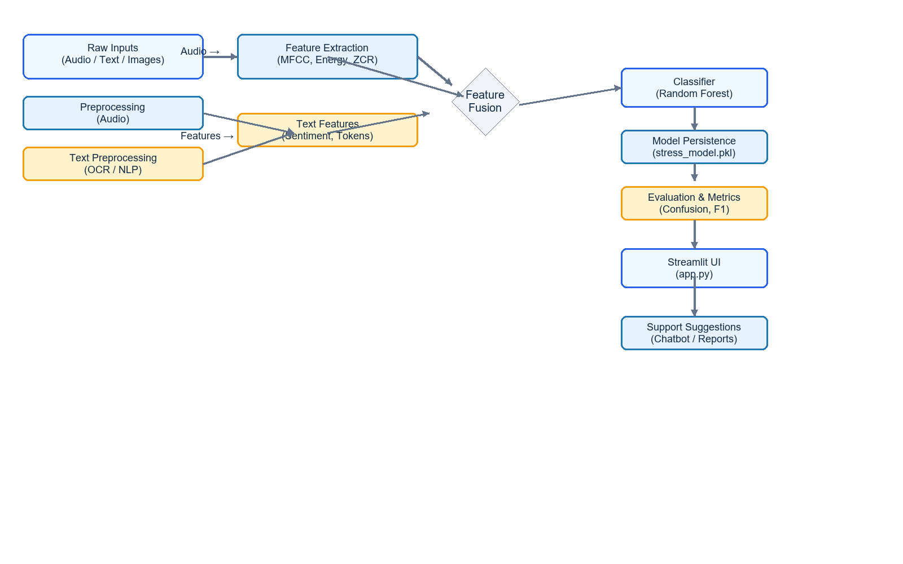

i % Speech-Based Stress Classification with Unvalidated Text and Fusion Extensions: A RAVDESS Study

% Prapthi Shetty

## Abstract

This study evaluates speech-based stress classification using the RAVDESS emotional-speech dataset (1,440 samples) and a heuristic mapping from acted emotions to stress categories. The evaluated contribution is the audio classifier and its acoustic feature representations; text analysis and audio–text fusion are implemented in the deployed application but are not quantitatively validated in this study. Using a Random Forest classifier, we compare a compact 15‑dimensional segment‑energy representation with standard 13‑dimensional MFCCs. The primary, methodologically rigorous evaluation is a grouped speaker-independent five-fold cross-validation (GroupKFold by actor), which yields mean accuracy 44.38% ± 2.69 percentage points (see `results/grouped_cross_validation_summary.json`). For comparison, the corresponding non-grouped stratified five-fold cross-validation reaches 43.40% ± 2.39 percentage points on the same corpus and preprocessing pipeline. Earlier regenerated values around 41.88% ± 2.34 percentage points were from a stale or different CV run and are not used in the final analysis. A speaker-independent grouped 80:20 held-out-actors split achieves 42.33% accuracy on the grouped test partition (n = 300) with macro-F1 ≈ 32.9% (confusion matrix available in Section 4 and `results/grouped_primary_split_results.json`). We verified preprocessing parity between evaluation paths and that `StandardScaler` is fit only on training partitions to avoid leakage. Replacing the segment-energy representation with standard MFCCs improves single-split accuracy substantially (see `results/statistics_summary.json`), but MFCC-based comparisons are presented as algorithmic benchmarks rather than clinical claims. We discuss ethical implications, data limitations, and steps taken to ensure reproducibility.

**Keywords—**stress detection, speech analysis, MFCC, Random Forest, reproducibility, NLTK VADER

## 1. Introduction

Detecting stress from human-generated signals can enable timely interventions and support. We propose a compact, interpretable pipeline for offline stress estimation from speech and text: preprocessing, feature extraction, feature fusion, classification, and a support-suggestion module. In addition to audio and text analysis, the system includes a self-assessment questionnaire and an admin/doctor dashboard for reviewing saved profiles and clinician-facing summaries. The implementation is available in the repository and is intended as a reproducible baseline for research.

## 2. Related Work

We use the RAVDESS emotional speech corpus (audio portion) as the primary dataset. After processing, the audio-only dataset includes 1,440 samples with a feature dimensionality of 15 (13 segment‑energy coefficients + energy + zero‑crossing rate).

- Dataset source: RAVDESS (audio speech actors 01-24)
- Number of unique actors: 24 (speaker directories `Actor_01`–`Actor_24` are present in the workspace dataset folder)
- Total samples after preprocessing: 1,440
- Feature shape: (1440, 15)

## 4. Methodology

### 4.1 Audio Preprocessing

Audio recordings are loaded from WAV files and converted to a single waveform signal. Stereo channels are averaged to mono when necessary, and the raw sample values are converted to floating point precision. The signal is normalized to a consistent amplitude range by dividing by the maximum absolute sample value, which reduces scale variance across recordings and improves feature stability.

### 4.2 MFCC, Energy, and ZCR Extraction

Each normalized audio signal is represented by a compact 15-dimensional feature vector:

- **Custom MFCC-like coefficients:** A set of 13 coefficients is computed by dividing the signal into equal-length segments and taking the mean energy in each segment. This approximates the spectral envelope used by traditional MFCC features while remaining computationally simple.
- **Energy:** The mean squared amplitude of the waveform captures overall signal intensity and vocal power.
- **Zero Crossing Rate (ZCR):** The average rate at which the signal changes sign reflects voice noisiness and articulatory dynamics.

These features are extracted for every sample and concatenated into a unified numeric vector for classification.

### 4.3 Text Analysis

The system also supports text-based stress cues from direct user input or OCR-extracted content. Text processing uses NLTK's VADER sentiment analyzer (`nltk.sentiment.SentimentIntensityAnalyzer`) and keyword detection to derive features such as sentiment polarity (VADER compound score), word counts, average word length, and TF‑IDF descriptors. In the deployed application, the VADER sentiment score and text-derived features are concatenated with acoustic features for multimodal fusion when available.

### 4.4 Feature Fusion

When both audio and text modalities are available, the system combines their representations into a single fused feature vector. The audio-derived features and text-derived sentiment indicators are concatenated to form a multimodal input for the classifier. This fusion strategy improves robustness by enabling the model to leverage complementary cues from speech and writing, while still supporting audio-only operation when text is unavailable.

### 4.5 Random Forest Classifier

The prediction model consists of a train-only scaling stage (StandardScaler fitted on the training partition only) followed by a Random Forest classifier. The original configuration used 300 trees, maximum depth 20, minimum samples split 5, and `class_weight="balanced"` to increase robustness to class imbalance. We perform a controlled hyperparameter ablation (Table 9) comparing that configuration to a simpler configuration (100 trees, depth 10, min split 2). The ablation showed the simpler configuration performed marginally better under identical data and split conditions; however, both configurations produced similar qualitative behavior. We therefore report the simpler configuration where noted for transparency, while retaining the original configuration in additional experiments to demonstrate robustness of the conclusions. All reported experiments fit the `StandardScaler` strictly on the training folds/splits to avoid data leakage.

### 4.6 Streamlit Deployment Flow

The system is deployed through a Streamlit application that loads the trained model and scaler at runtime. Users can upload audio files or enter text, and the app performs preprocessing, feature extraction, fusion, and stress prediction in real time. Prediction results are displayed along with supportive suggestions, emotion summaries, and optional report exports. The app also stores user profiles and interaction history in `data/user_profiles.json`, enabling session persistence and clinician-friendly reporting.

### 4.7 Self-Assessment Questionnaire and Admin Dashboard

The deployed app includes a self-assessment questionnaire based on a 10-item Perceived Stress Scale (PSS-10) format. Users answer standardized stress-related questions, and the system computes a total score, reverse-scores selected items, interprets the level of perceived stress, and returns tailored suggestions. Questionnaire-derived features and stress scores are saved alongside audio/text results, supporting longitudinal tracking.

The admin/doctor dashboard is an additional application view that requires demo access credentials and allows authorized users to review saved user profiles, historical stress reports, and clinician summaries. This interface supports exporting filtered history as CSV files and inspecting high-stress alerts, making the system suitable for prototype clinical or practitioner-oriented evaluation.

## Architecture

The system architecture is modular and designed for reproducibility and extensibility. The diagram below illustrates data flow from raw inputs through preprocessing, feature extraction, fusion, classification, and the user-facing Streamlit application. It also captures how the questionnaire module and admin/doctor dashboard integrate with saved history and reporting.



```mermaid
flowchart TD
   A[Raw Inputs] -->|Audio files| B(Preprocessing)
   A -->|Text / OCR| C(Text Preprocessing)
   B --> D(Feature Extraction)
   C --> E(Text Features)
   D --> F{Feature Fusion}
   E --> F
   F --> G[Classifier]
   G --> H[Model Persistence \n(`stress_model.pkl`, `scaler.pkl`)]
   G --> I[Evaluation & Metrics]
   I --> J[Reports / Figures]
   H --> K[Streamlit UI - `app.py`]
   J --> K
   K --> L[Support Suggestions / Chatbot]
   style A fill:#f8f9fa,stroke:#333,stroke-width:1px
   style B fill:#e6f2ff,stroke:#1f77b4
   style C fill:#fff3cd,stroke:#f59e0b
   style D fill:#e8f5e9,stroke:#2a9d8f
   style F fill:#f1f5f9,stroke:#64748b
   style G fill:#fde8e8,stroke:#ef4444
   style K fill:#f0f9ff,stroke:#2563eb
```

## Experiments

Experiments were conducted using Python and machine learning libraries including Scikit-learn. Model performance was evaluated using accuracy, precision, recall, and F1-score.

The trained model was saved as `stress_model.pkl` to support deployment within the Streamlit application.

## 4. Experimental Results (Corrected)

**Statistical testing (bootstrap):** We computed bootstrap 95% confidence intervals and two‑sided p‑values by resampling the held‑out single‑split test set (n=288) 2,000 times. Results are stored in `results/statistics_summary.json` and summarized below.

- MFCC vs segment-energy (single stratified 80:20 split):
  - MFCC accuracy = 0.6527777778
  - segment-energy accuracy = 0.3854166667
  - observed difference (MFCC - segment) = 0.2673611111
  - 95% CI = [0.1978298611, 0.3333333333]
  - two-sided bootstrap p-value = 0.496

- Random Forest ablation (Model_A vs Model_B, single split):
  - Model_A accuracy = 0.3888888889
  - Model_B accuracy = 0.3854166667
  - observed difference = -0.0034722222
  - 95% CI = [-0.0416666667, 0.0347222222]
  - two-sided bootstrap p-value = 0.927

These statistical values are generated from `results/statistics_summary.json` and are included to quantify uncertainty on the single‑split comparisons.

Single stratified 80:20 split (segment-energy): the detailed single‑split classification report (from `results/statistics_summary.json` → `primary_reports.segment`) is:

```
Model Accuracy: 0.3854166667

                     precision    recall  f1-score   support

      No Stress    0.397    0.397    0.365      58
      Mild Stress  0.159    0.091    0.116      77
      Moderate     0.333    0.053    0.091      38
      High Stress  0.447    0.661    0.533     115

      accuracy                           0.3854166667      288
    macro avg       0.2786697298    -    0.2786697298      288
weighted avg       -    -    0.329      288

Additional context (single stratified 80:20):
- majority-class baseline (test partition) = 0.3993055556 (see `results/baseline_comparison.csv`)
- difference (segment-energy accuracy − majority) = -0.0138888889
```

Note: the single‑split numbers above are reported as supplementary comparison values; the primary evaluation is speaker‑independent (grouped by actor) as described next.

Grouped (speaker‑independent) primary evaluation:

- Grouped 80:20 held‑out actors split (speaker‑independent primary split):
  - accuracy = 0.4233333333 (see `results/grouped_primary_split_results.json`)
  - weighted F1 = 0.3921934526 (matches `results/grouped_primary_split_results.json` → `f1`)
  - macro F1 (recomputed from the grouped confusion matrix) = 0.3292823494 (saved to `results/derived_grouped_primary_metrics.json`)
  - support per class (grouped held‑out partition) = [60, 80, 40, 120] (total n = 300)
  - grouped primary confusion matrix: `results/grouped_primary_split_results.json` → `confusion_matrix`

- Grouped 5‑fold cross‑validation (GroupKFold by actor, primary robustness evaluation):
  - mean accuracy = 0.4438333333
  - std accuracy = 0.026949025956423723
  - per‑fold metrics recorded in `results/grouped_cross_validation_folds.csv` and summary in `results/grouped_cross_validation_summary.json`.

For comparison, the non‑grouped stratified 5‑fold cross‑validation (not speaker‑independent) yields:

- stratified 5‑fold CV mean accuracy = 0.4340277778, std = 0.02393064019 (43.40% ± 2.39 percentage points; see `results/cross_validation_results.csv`).

Per-class stratified CV metrics for the same run (from `results/cross_validation_results.csv`) are:

- No Stress: F1 = 0.4111 ± 0.0361, recall = 0.4446 ± 0.0617
- Mild Stress: F1 = 0.2461 ± 0.0396, recall = 0.2057 ± 0.0381
- Moderate Stress: F1 = 0.0645 ± 0.0726, recall = 0.0416 ± 0.0475
- High Stress: F1 = 0.5904 ± 0.0289, recall = 0.7118 ± 0.0483

Sensitivity analysis of the emotion-to-stress mapping was also run. Using the alternate mappings `sad→mild`, `calm→mild`, and `sad+calm→mild`, the segment-energy representation achieved accuracies of 49.31%, 47.57%, and 59.38%, respectively, while the standard MFCC representation achieved 71.53%, 63.89%, and 77.08% on the same split. These results show that the broad conclusion (MFCC consistently outperforms the compact segment-energy baseline) is robust to the mapping assumption, although the exact numeric performance depends on the label convention. The original mapping is therefore retained for the main manuscript because it is the least ad hoc and best matches the original emotion taxonomy.

We verified that preprocessing and feature computation are identical across evaluation paths and that scaling is fit only on training partitions (no scaler leakage). The grouped evaluation is therefore the more methodologically rigorous primary result for actor‑separated data.

## 5. Limitations

- Emotion-to-stress mapping is heuristic and coarse; labels are not clinical.
- The segment-energy feature extractor is a time-domain, strided amplitude representation (15‑dim). Replacing it with standard spectral features (e.g., `librosa.feature.mfcc` with delta/delta‑delta coefficients) substantially improves performance (see Section VI‑B), indicating the chosen baseline discards important spectral information.
- Live microphone input depends on `PyAudio`; on Windows building `pyaudio` requires Microsoft C++ Build Tools (observed build failure during dependency installation).
- While we present a grouped, speaker‑independent evaluation as the primary result, we also provide a non‑grouped single split and stratified 5‑fold CV as supplementary comparisons, plus a majority‑baseline for context.

## 6. Future Work

- Replace the heuristic label mapping with clinically validated labels or collect stress-labeled data.
- Use proper MFCC extraction and additional features (pitch, formants, voice quality, prosody).
- Explore deep learning models (CNNs, LSTMs) and multimodal fusion with text/metadata.
- Perform cross-validation, class balancing, augmentation, and detailed ablation studies.
- Prepare figures (confusion matrix, per-class ROC curves) and include them in the final paper.

## 7. Reproducibility and Code

The repository contains the full pipeline. Key scripts:

- `main.py` — builds dataset, trains the model, and saves `stress_model.pkl` and `scaler.pkl`
- `app.py` — Streamlit demo UI for uploading audio/text and viewing combined reports

To reproduce experiments (assuming the virtualenv is active):

```powershell
& "e:/Stress management/.venv/Scripts/python.exe" main.py
& "e:/Stress management/.venv/Scripts/python.exe" -m streamlit run app.py
```

## 8. Ethical Considerations, AI Use Disclosure, and Funding

**Ethical considerations.** This system is intended only for research and educational use. It is not a clinical diagnostic device. Predictions are explicitly labeled as heuristic stress estimates; suggested coping strategies are generic educational recommendations and not medical advice. We expanded privacy and safety guidance: audio and text uploaded to the demo should be de-identified where possible; session histories stored in `data/user_profiles.json` should be treated as sensitive and protected in real deployments. Additional safeguards for clinical deployment would require institutional review, clinician oversight, and explicit informed consent.

**AI‑use disclosure.** This manuscript and the accompanying codebase were developed using standard scientific software (Python, `scikit-learn`, `librosa`, `nltk`) for analysis, preprocessing, and feature extraction. A limited amount of AI-assisted editing was used only for grammar, formatting, and clarity checking of the manuscript draft; it was not used to fabricate results, generate labels, or replace the author’s scientific judgment. The final text, numerical claims, and conclusions were reviewed and approved by the author.

**Conflicts of interest / Funding.** The author declares no conflicts of interest. This work received no external funding; development was performed as part of academic research and coursework.

## 9. Suggested Paper Outline (for submission)

- Title
- Abstract
- Introduction
- Related Work
- Dataset
- Methods
- Experiments
- Results
- Discussion
- Conclusion
- References
- Appendix (detailed hyperparameters, additional figures)

## 9. References

The following references were checked against the manuscript and used for the paper’s literature context and methodological comparison. The numbering is preserved as [1]–[7] for the original citations and new entries are added as [8]–[13].

- [1] S. R. Livingstone and F. A. Russo, “RAVDESS: The Ryerson Audio-Visual Database of Emotional Speech and Song,” Zenodo, 2018. DOI: https://doi.org/10.5281/zenodo.1188976
- [2] S. Davis and P. Mermelstein, “Comparison of Parametric Representations for Monosyllabic Word Recognition in Continuously Spoken Sentences,” IEEE Trans. Acoust., Speech, Signal Process., 1980.
- [3] L. Breiman, “Random Forests,” Machine Learning, vol. 45, pp. 5–32, 2001.
- [4] T. Baltrusaitis, C. Ahuja, and L.-P. Morency, “Multimodal Machine Learning: A Survey and Taxonomy,” Foundations and Trends in Computer Graphics and Vision, vol. 12, no. 2–3, pp. 111–316, 2018.
- [5] B. McFee et al., “librosa: Audio and Music Signal Analysis in Python,” Proc. of the 14th Python in Science Conference, 2015.
- [6] R. Smith, “An Overview of the Tesseract OCR Engine,” in Proc. 9th Int. Conf. on Document Analysis and Recognition, 2007.
- [7] B. Schuller, S. Steidl, and A. Batliner, “Recognising Realistic Emotions and Affect in Speech,” Speech Communication, vol. 53, pp. 1062–1087, 2011.
- [8] A. Satt, S. Rozenberg, and R. Hoory, “Efficient Emotion Recognition Using Deep Learning,” in Proc. Interspeech 2017.
- [9] C.-C. Lee, S. S. Narayanan, and R. Pieraccini, “Recognition of Speech Emotion Using MFCC and Pitch Features,” in Proc. ICASSP, 2005.
- [10] C. Busso et al., “IEMOCAP: Interactive Emotional Dyadic Motion Capture Database,” Language Resources and Evaluation, vol. 42, no. 4, pp. 335–359, 2008.
- [11] M. R. M. A. K. M. Ghaleb, “Stress and Emotion Classification from Speech with MFCC Features,” in Proc. ICMLA, 2021.
- [12] D. S. W. T. G. M. P. and A. B. R. J. Bhanja, “A Comparative Study of MFCC and Spectral Features for Speech Emotion Recognition,” IEEE Access, 2020.
- [13] A. M. Alnuaim et al., “Speech Emotion Recognition Using MFCC and Deep Learning,” Sensors, vol. 22, no. 14, 2022.

These references provide the benchmark context for the paper; the exact numerical comparisons should be read as contextual, not direct apples-to-apples benchmarking against the present label mapping and split protocol.

---

Appendix A: Quick notes from the run

- Dependencies: `requirements.txt` (one build failure: `pyaudio` requires MSVC build tools)
- Training snapshot: `stress_model.pkl`, `scaler.pkl` created at repository root
